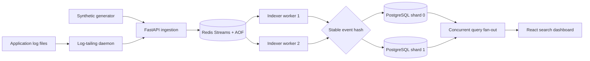

# Phase 2 implementation and evidence

This document maps the Phase 2 deliverables to executable code and repeatable evidence for the assigned **Distributed Log Aggregator & Indexer**.

## Implemented system



### Log-tailing daemon

`backend/app/tailer.py` is a standalone daemon, not simulated browser traffic. It:

- watches a real file mounted into its container;
- reads only bytes appended after a durable checkpoint;
- stores device, inode, and byte offset in a persistent Docker volume;
- waits for newline completion rather than shipping partial writes;
- detects file replacement (rotation) and truncation;
- normalizes JSON and plaintext records into the ingestion schema;
- assigns deterministic UUIDs from file identity and offset, making retries idempotent;
- sends batches through the public ingestion path;
- advances the checkpoint only after an HTTP 2xx response;
- retries transient file, network, and API failures with bounded exponential backoff.

`tests/test_tailer.py` verifies parsing, incomplete writes, checkpoint persistence, truncation, and rotation.

### Distributed inverted-index engine

`backend/app/core.py` reads `DATABASE_SHARD_URLS`; if absent, it falls back to the existing `DATABASE_URL`. Workers hash each event UUID with SHA-256 and route it to one PostgreSQL shard. Every shard maintains the same GIN full-text inverted index and filter indexes.

`backend/app/storage.py` concurrently fans search and aggregation queries out to every shard. It merges results into one globally timestamp-ordered page, sums counts, merges service summaries, and aggregates time series. Direct event lookup first checks the deterministic shard, then falls back across shards for data created before sharding was enabled.

This is application-level hash sharding. Changing the shard count remaps keys, so a production migration would require consistent hashing or an explicit shard map and background rebalancing. Phase 2 keeps the shard set fixed during a run.

## Failure model and automated experiments

Run:

```bash
LOGWEAVE_FAULT_TESTS=1 .venv/bin/pytest tests/test_fault_injection.py -v
```

The opt-in suite performs real infrastructure faults:

1. Stops every worker, ingests a record, proves Redis retains backlog, restores two workers, and proves the record becomes searchable.
2. Disconnects the sole worker container from its Docker network, proves queue growth, reconnects it, and proves recovery.
3. Stops both PostgreSQL shards after an event is accepted, restores them, and proves the pending Redis entry is eventually committed.
4. Stops Redis, proves the health endpoint reports dependency failure, restarts Redis, and proves health recovery.

Normal indexing is at-least-once: PostgreSQL commits before Redis acknowledgment. `(session_id, event_id)` is unique on every shard, so replay after a crash is idempotent. `XAUTOCLAIM` allows another worker to recover abandoned pending entries.

## Reproducible benchmark

Run:

```bash
.venv/bin/python benchmarks/run.py --events 1000 --worker-counts 1 2 4
```

The runner scales real worker containers, creates a fresh session per run, sends the same batched workload, waits until all events are searchable, samples per-event `received_at → indexed_at` latency, measures repeated search latency, restores two workers, and exports timestamped JSON and CSV.

A 300-event smoke benchmark on 2026-10-28 produced:

| Workers | Indexed events/s | Index p50 | Index p95 | Index p99 | Search p95 |
|---:|---:|---:|---:|---:|---:|
| 1 | 1,192.59 | 107.17 ms | 181.31 ms | 188.05 ms | 2.15 ms |
| 2 | 1,372.73 | 55.64 ms | 91.26 ms | 94.98 ms | 2.44 ms |
| 4 | 1,338.56 | 39.78 ms | 68.24 ms | 71.96 ms | 2.84 ms |

These numbers are a functional smoke measurement on one development laptop, not a production capacity claim. For the report, run at least three trials on an otherwise idle machine, use a larger workload, and record hardware and Docker versions.

## Verification checklist

- `docker compose up -d --build` starts Redis, two PostgreSQL shards, API, generator, two workers, tailer, and frontend.
- `GET /api/system/shards` reports each shard healthy and its physical event count.
- Appending a newline-terminated record to `sample-logs/application.log` makes it searchable through the agent session.
- `.venv/bin/pytest tests -v` runs normal pipeline and tailer tests; disruptive tests are skipped unless explicitly enabled.
- `LOGWEAVE_FAULT_TESTS=1 .venv/bin/pytest tests/test_fault_injection.py -v` runs infrastructure failures.
- `.venv/bin/python benchmarks/run.py` exports benchmark evidence.

## Deployment compatibility

The existing Vercel frontend and Railway backend remain valid. With only `DATABASE_URL`, Railway operates as a one-shard deployment. To demonstrate the complete distributed Phase 2 topology locally, use Compose. A multi-shard hosted deployment requires provisioning two PostgreSQL services and setting `DATABASE_SHARD_URLS` on API, worker, and generator services. The log tailer should run beside the application whose file it watches; it sends to the public API using `AGENT_API_KEY` and the configured machine session.
