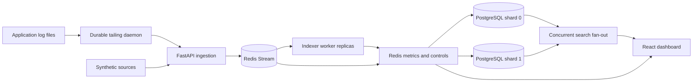
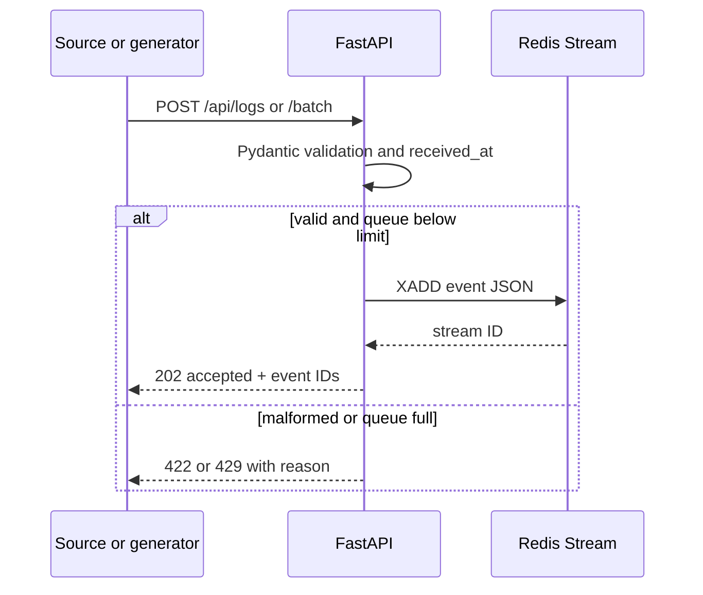
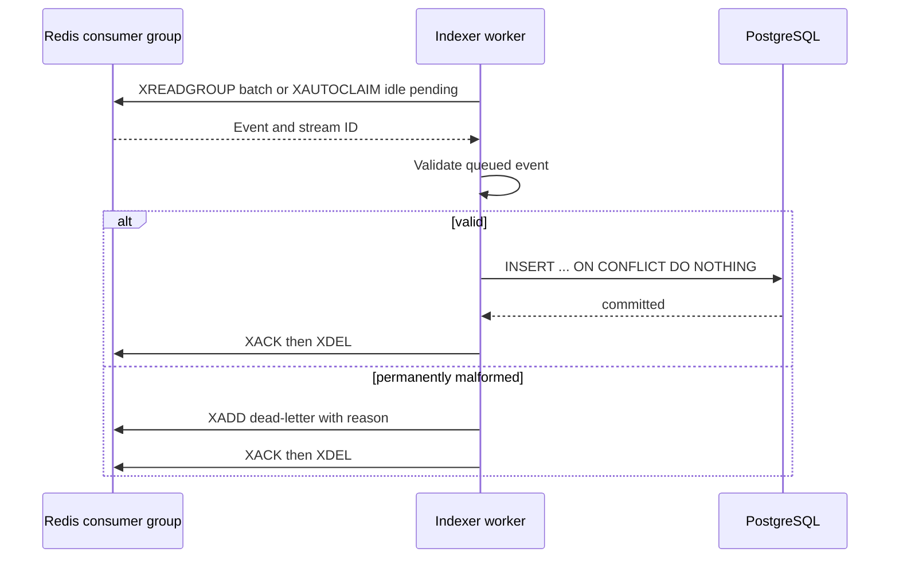
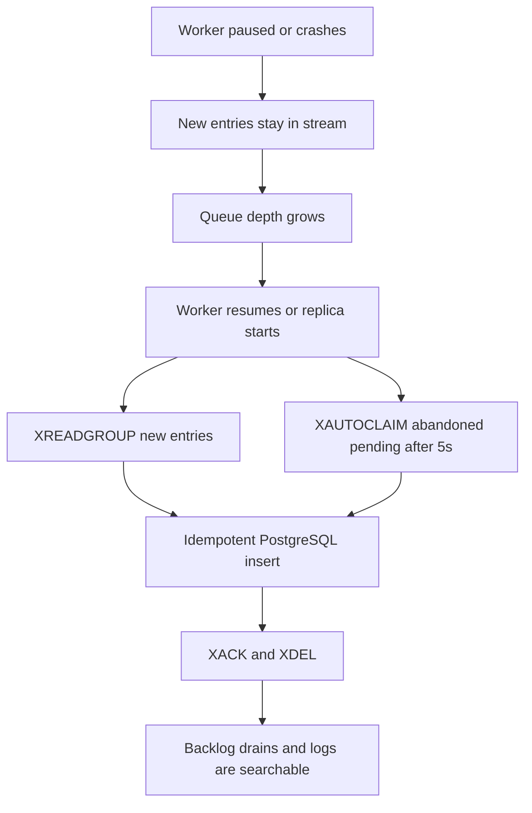

# Distributed Log Aggregator & Indexer system design

## Problem and objectives

Application logs spread across services are difficult to search and reason about. The Distributed Log Aggregator & Indexer centralizes structured events, buffers bursty traffic, indexes with multiple processes, and exposes search and measured operating state. The classroom objective is to demonstrate queue growth, worker failure, recovery, and scaling with real infrastructure.

## Functional and non-functional requirements

The system tails real files, ingests one event or a batch, validates structure, reports JSONL import errors, queues accepted events, indexes them idempotently across shards, supports filtered full-text search, and exposes live metrics and controls. It favors clear failure behavior, reproducibility, local resource use, and maintainable modules over maximum throughput. Benchmark results are treated as environment-specific measurements rather than production capacity claims.

## High-level architecture

The generator runs as one dedicated process and posts to the ingestion HTTP route with the visitor's anonymous session cookie. Each visitor has a separate Redis stream and controls; every PostgreSQL query is scoped to that session. Indexers are separate containers and consumer names. Compose starts two; more can be added with `--scale worker=N`.

## Log ingestion sequence

## Log indexing sequence

## Failure and recovery

## Log tailing, data model, and indexing

The standalone tailer persists the source file's device, inode, and accepted byte offset. It never advances the offset before a successful batch response. Deterministic event UUIDs keep a retried line idempotent. Inode changes and size regression detect rotation and copy-truncate workflows.

Each shard's `log_events` table has `(session_id,event_id)` as its primary key; event timestamp, service, host, severity, message, trace ID, JSONB metadata, received time, indexed time, and generated `search_vector`. B-tree indexes cover time, `(service,time)`, `(severity,time)`, and non-null trace ID. GIN indexes `search_vector`. Workers use stable SHA-256 modulo routing by event UUID. Search combines optional filters with `AND`, queries every shard concurrently, merges by timestamp, and returns one page. Keyset pagination and a shard map would be preferable at very large scale.

## API design

- `POST /api/logs`, `/api/logs/batch`, `/api/logs/import`: ingestion and JSONL.
- `GET /api/logs`, `/api/logs/{event_id}`: filter and inspect events.
- `GET /api/services`, `/api/stats`: service and stored volume summaries.
- `GET /api/metrics`, `/api/metrics/stream`: current counters and SSE.
- `POST /api/generator/{start,pause,stop,burst}`: traffic controls.
- `POST /api/workers/control`, `/api/workers/{name}/control`: pause or slow consumers.
- `POST /api/demo/reset`, `/api/retention/run`: local data lifecycle.

## Delivery, fault tolerance, and consistency

Delivery is at least once. Workers acknowledge only after a successful database insert; PostgreSQL unique event IDs make repeated inserts safe. A crash before acknowledgment leaves a pending entry for `XAUTOCLAIM`. A crash after acknowledgment but before deletion can leave an acknowledged stream entry; local monitoring uses `XLEN`, so that rare orphan can overstate backlog until cleanup. API publication and its Redis metric increment are separate operations; a crash between them can slightly undercount received events. There is no atomic transaction across Redis and PostgreSQL. Search reflects committed rows, so it is eventually consistent with ingestion.

Backpressure uses a maximum stream length of 100,000; requests receive 429 above that threshold. Unexpected processing exceptions leave entries pending and count errors. Permanently malformed queued records go to a dead-letter stream. Redis AOF `everysec` and PostgreSQL volumes persist local state across container restarts.

## Scaling and trade-offs

More consumer replicas can improve throughput while Redis, PostgreSQL shards, and CPU allow. A per-event insert and acknowledgment keep behavior easy to teach but cost throughput. The two local PostgreSQL services demonstrate physical index distribution; `DATABASE_SHARD_URLS` can contain any fixed number of shards. Bulk inserts, consistent-hash rebalancing, stronger rate accounting, authentication/authorization, and a production metrics stack would be future steps. The injected delay is a real delay in worker processing; it is a failure experiment control rather than a simulated metric.
